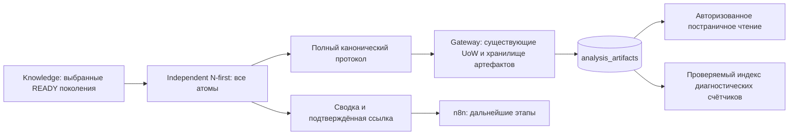

<!-- docs/check-norms-lossless-delivery.md -->

# Check Norms: ограниченный транспорт и полный протокол N-first

Дата: 23.10.2026. Ветка: `feature/quality`.

## A. Первопричина и измерения

В инциденте `9d3e7e21-fd11-4601-8ba3-318aa5ade806`, document_id
`b587676d-872d-49d3-91a5-63a80505be30`, сервис вернул HTTP 200 после 31 страницы.
Сообщение StringDecoder в n8n относится к декодированию ответа. Размер именно
того серверного ответа не сохранён и этой работой не измерен. Ошибка не объявляется
следствием HTTP 503, рестарта, heap или нехватки GPU.

В production-коде полный `independent.diagnostics` включался в HTTP metrics.
Каждый RequirementRecord содержал цитату, observations, currency evidence и
source_reference. `dataclasses.asdict` рекурсивно копировал эти вложения.
Workflow переносил metrics дальше, включая окончательный результат.

Регрессия сначала выполнена на прежнем поведении: три RED-теста для 1, 31 и
50 страниц упали по бюджету 8 MiB. Учебный корпус содержал 10 412 атомов и
11 документов, без готовых модельных замечаний. Измеренный JSON metrics:
138 368 108 bytes / 131,958 MiB, в том числе checks — 135 990 604 bytes,
selection — 2 373 672 bytes. Измерение выполнялось JSONEncoder.iterencode без
создания строки предельного размера.

Затем fixture уточнена: 11 разных SHA-256 и согласованные документы подтверждения
статуса. Это добавляет настоящую ветвь currency evidence. Полная несокращённая
проекция такого корпуса занимает 173 197 427 bytes / 165,174 MiB при стандартных
разделителях JSON. Это синтетическое измерение структуры, не замер инцидента.
Отдельный сквозной fixture проходит настоящий HttpNormativeRequirementsReader и
его нормализацию статусов. Из его сохранённого протокола повторно измерена прежняя
полная проекция metrics. Она отличается от unit-fixture выше; размеры не смешиваются.

| Структура сквозного HTTP-fixture | Bytes | MiB |
| --- | ---: | ---: |
| Полные прежние independent metrics | 138 953 060 | 132,515965 |
| checks, 10 412 записей | 136 552 852 | 130,226948 |
| Вложенные source_reference, 10 412 | 101 454 264 | 96,754326 |
| selection | 2 373 672 | 2,263710 |
| Настоящий итоговый FastAPI CheckNormsStageResponse | 16 556 | 0,015789 |
| Полный канонический архив | 36 727 807 | 35,026366 |

В архиве 10 412 источников и 41 743 узла. Два повторяемых длинных текстовых узла
занимают 2 716 UTF-8 bytes и имеют 41 661 прямую ссылку из DAG. Это счётчик прямых
ссылок, не оценка рекурсивно развёрнутого размера. Сохраняются разные ID документов,
атомов и поколений; совпадение цитат не объединяет их идентичность.
Измерения записаны в `serialization-measurements.json` и
`normative-source-measurements.json`, без нормативных цитат.

Оба опыта подтверждают механизм размножения данных, но не воспроизводят фактическое
достижение лимита `0x1fffffe8` серверного n8n. Лимит Node искусственно не достигался.
tracemalloc применяется отдельно к 128 атомам и показывает Python allocations
этой выборки; это не RSS сервиса и не оценка памяти корпуса из 10 412 атомов.
Heartbeat полного HTTP-теста измеряет задержку тестового event loop, а не GPU:
максимум Windows-прогона — 1 332,52 ms. Это характеристика синтетического полного
запроса, не отдельное время сериализации и не гарантия производственной задержки.
На 128 атомах tracemalloc зафиксировал peak 739 976 bytes; прежний JSON выборки —
2 133 447 bytes, компактная сводка — 5 050 bytes. На полный корпус эти числа
не экстраполируются.

## B. Исправление, хранение и границы



Используются существующие PostgreSQL jobs, блокировка строки задания, UoW,
DI/runtime и том `analysis_artifacts`, общий для Gateway и worker.
Новые БД, сервисы и миграции не нужны. Knowledge, Qdrant, embedding, VLM,
промпты, confidence thresholds и исходные PDF не менялись.

Архив `pdrd.normative-protocol/v1` содержит все полученные атомы, включая
неотобранные по признакам объекта; полный selection, manifests, coverage,
checks, observations, source_reference, исходные тексты/координаты,
редакции, SHA-256, generation_id, нормативные статусы, вычисления и причины.
Также сохраняются исходные page-local metrics с планами N/T/U.
Количество checks берётся из созданных записей: один атом может создать несколько.

Повторяющиеся значения представлены типизированными content-addressed узлами.
Дедупликация использует точное содержимое с идентичностью источника, а не смысловую
близость. Разные документы, поколения и редакции восстанавливаются отдельно.
Буквальный ключ `$ref` внутри исходного JSON не становится служебной ссылкой.

Архив загружается напрямую Analysis → Gateway частями не более 256 KiB.
Gateway проверяет digest, ссылки, счётчики, исходные атомы, документ и нормативный
snapshot настоящего job. Публикация manifest выполняется атомарной заменой файла
после fsync. Неполный архив не доступен как ready. Идемпотентный повтор допускает
только одинаковые данные. Сетевой обрыв повторяет текущую операцию максимум
три раза с backoff 0,1/0,2 секунды; HTTP-ошибки не запускают автоматический повтор
анализа. Потеря ACK после записи проверяется отдельными тестами.

Файлы находятся под
`<API_GATEWAY_STORAGE__ROOT_PATH>/<document_id>/normative-protocols/<protocol_id>/`.
Стандартный корень — `/data/analyses`. Идентификатор протокола — SHA-256 архива.
Существующее удаление гостевых артефактов удаляет этот каталог вместе с заданием;
очистка только исходных PDF владельца оставляет аудит рядом с result.json.

Если запись не подтверждена, Check Norms возвращает ошибку, а не успешные нулевые
metrics. Отмена проверяется между частями и перед публикацией. Gateway повторно
проверяет отмену под блокировкой job. Перед сохранением конечного результата worker
проверяет привязку ссылок и наличие исходных частей, включая повторную доставку.

Бюджет каждого затронутого HTTP-ответа — 8 MiB; входной context pool со своим
пределом не изменялся. Размер измеряется потоково вне event loop, включая вычисляемые
поля DTO, с остановкой после превышения бюджета. Для больших обязательных findings
сохраняется весь результат, возвращается `results_reference`, а workflow читает
JSONL через обычный HTTP Request с пагинацией по 256 KiB исходных bytes. Code node
только проверяет/собирает записи; HTTP внутри Code sandbox не используется.
Выбор обычного HTTP Request соответствует
[документации Code node n8n](https://docs.n8n.io/integrations/builtin/core-nodes/n8n-nodes-base.code/).
Проверены PDF Check Norms, межстраничная проверка, Finalization и одиночные CAD /
PDF+CAD Check Norms и Finalization. Страницы, ID и доказательства не обрезаются.

Полный N-first не поступает в n8n даже при восстановлении больших findings.
Gateway diagnostics читает отдельную проверяемую проекцию счётчиков, а не разворачивает
для сводки все цитаты. Отсутствующий протокол вызывает ошибку / неизвестные показатели,
а не измеренные нули. Старые inline-планы поддерживаются.

## C. Файлы и API

Полный перечень для единственного коммита:
[check-norms-lossless-files.txt](check-norms-lossless-files.txt).
Полные исходники находятся в рабочей копии; ZIP и SHA-256 manifest выдаются отдельно.
Прикладной код frontend и PDF-рисования не изменялся. В frontend изменён только
тест маршрута workflow, чтобы он проходил новый resolver.

Публичное чтение:

```text
GET /api/v1/analyses/{job_id}/normative-protocols/{protocol_id}
GET /api/v1/analyses/{job_id}/normative-protocols/{protocol_id}?collection=checks&offset=0&limit=100
GET /api/v1/analyses/{job_id}/normative-protocols/{protocol_id}/parts/{index}
GET /api/v1/analyses/{job_id}/diagnostics/normative
```

Коллекции: `manifest`, `checks`, `selection`, `sources`, `nodes`, `page_metrics`,
`stage_records`. Лимит страницы 1–200, выдача ограничена примерно 1 MiB плюс оболочка.
`next_offset` задаёт продолжение в стабильном порядке. Очень большой отдельный объект
возвращается как encoded-ссылка; полный архив доступен через byte parts.
Для восстановления архива нужно объединить parts по номеру, проверить SHA-256,
прочитать schema/roots/nodes и раскрыть типизированные object/array/text узлы.
Это исходный протокол, не реконструкция из PDF.

Права проверяются по настоящему job: владелец / разрешённая область / действующий
гостевой capability. UUID документа не заменяет job_id. В режиме разработки без
auth-профиля новый API также требует capability. Ответы не кешируются.
Отсутствующий job/протокол даёт 404; неверная пагинация/коллекция/ID — 422;
неподтверждённое хранение или нарушенная целостность — ошибку, не пустой список.
Внутренние upload и stage-stream доступны через существующую внутреннюю сеть Gateway.

## D. Проверки

Первый RED: **3 failed**, причина — превышение бюджета при всех 10 412 checks.
Полный Windows gate `ops/check-quality.ps1`: **3255 passed, 128 skipped за 303,74 s**;
**405/405 JavaScript**, pip check, Ruff lint, Ruff format и git diff --check прошли.
Пропуски включают PostgreSQL-наборы, которые штатно запускаются отдельно в Linux.
Лог: `.codex-test-temp/check-norms-quality-windows.log`.

Предварительный GREEN новых сценариев: **19 passed за 67,92 s** до добавления защиты
одиночных CAD; отдельные четыре CAD/PDF+CAD сценария и streaming-budget:
**5 passed за 9,37 s**. Финальный Windows gate включает все эти сценарии.
Штатный `bash ops/check-quality.sh` завершился с кодом 0, все **7/7 этапов**:

| Linux-набор | Результат | Время pytest |
| --- | --- | ---: |
| Общий Python, Python 3.12 | 3256 passed, 127 skipped | 285,58 s |
| JavaScript | 405 passed | — |
| Gateway PostgreSQL | 6 passed | 0,88 s |
| Knowledge PostgreSQL | 41 passed | 8,04 s |
| Experience PostgreSQL | 49 passed | 5,81 s |
| User PostgreSQL | 31 passed | 3,58 s |
| Auth PostgreSQL | 14 passed | 1,91 s |
| Equipment PostgreSQL | 128 passed | 15,53 s |

Итого отдельно от общего набора — **269 PostgreSQL integration tests**.
Gateway включает новые проверки публикации, рестарта и блокировки отмены.
Тестовые БД изолированы, рабочая БД не использовалась; штатный gate удалил свои
тестовые контейнеры и сети. Лог: `.codex-test-temp/check-norms-quality-linux.log`.
Первый запуск остановился до тестов из-за отсутствующих локальных переменных
Compose. Успешный запуск получил фиктивные значения PDRD_POSTGRES_PASSWORD,
PDRD_RABBITMQ_PASSWORD и PDRD_EQUIPMENT_INTERNAL_KEY только в окружении процесса
для разбора общего Compose. Production-профили не запускались.

Сценарии включают 1/31/50 страниц, 12 000 атомов, большие вложенные JSON-объекты,
несколько observations и несколько checks одного атома, точное восстановление
источников, рестарт адаптера, потерю ACK, ограничение retry, отмену, недописанные и
повреждённые части, подмену scope, чужой job, отсутствие протокола и проверку ingestion.
Большие transport fixtures не являются тестом инженерного обнаружения.
Независимый N-first делает **0 новых VLM и 0 embedding вызовов**.

## E. H09 / H10 / H16 / H24

Контроль выполняет действующий алгоритм над исходными текстовыми/табличными fixtures
и структурированными фактами, затем настоящий HTTP N-first → D → Finalization →
filesystem result. Готовые ожидаемые замечания на вход не подаются.

| Кейс | Результат на контрольных данных | Доказательства и ограничения |
| --- | --- | --- |
| H09 | confirmed | В2: водоснабжение / водоотведение, страницы 8, 13, 14; одна инженерная претензия, факты и регионы сохраняются |
| H10 | needs_review | 147 м трассы и 150 м поставляемой трубы, страницы 13, 26; разные роли величин не объявляются нарушением |
| H16 | needs_review | 0,5205 и 0,205 л/с, страницы 15, 30; сохраняются строки/заголовки/геометрия и вопрос о сопоставимости условий |
| H24 | confirmed | На странице 20 проверяется действительная ссылка и название таблицы, не отсутствие текста на одном листе |

Все четыре сохраняют статус, исходные факты, evidence_locations, visual_regions
и object_ref после Finalization и записи результата. Служебная история решений
может дополняться; она не принимается за неизменяемый исходный факт.
Для H10 управляющие строки графической спецификации — тестовые структурированные
данные. Это не подтверждение нового VLM-извлечения страницы 26. Матрица H01–H35
по-прежнему предварительная, не нормативный gold standard. Рост Recall реальной
модели этими тестами не измерен.

## F. Windows и Git

Исходный и итоговый HEAD рабочей копии без коммита:
`6507e40cdda89f0e85d499d56fabeeea71577e65`. Этот SHA ветки подтверждён GitHub;
`main` — `8fd5adcdf1db9088f182f69bee7e7df1ef9ca2b1`.
Правила прочитаны из shared-infrastructure, HEAD
`8b04d082424245372b54702939cc45b01abe389b`.
Изменения подготовлены для одного коммита. Агент не индексирует, не коммитит и
не пушит; SHA коммита появится после команды пользователя. Итоговый manifest
содержит 44 изменённых/новых файла; Git index пуст. Большие fixtures, логи и
выходной ZIP находятся в игнорируемом `.codex-test-temp`, в коммит не входят.

После завершения gates появилась параллельная работа Knowledge Service, включая
два дополнительных production-файла ниже и их тесты. Эти изменения не создавались
и не редактировались в этой задаче, не входят в manifest поставки и не покрыты
приведёнными результатами проверок. Снимок списка записан в `verification.json`:

- `services/knowledge-service/src/pdrd_knowledge_service/application/use_cases/restart_blocked_normative_requirements.py`;
- `services/knowledge-service/src/pdrd_knowledge_service/transport/cli/restart_blocked_normative_requirements.py`.

```powershell
Set-Location C:\Users\i.mein\PycharmProjects\PDRD-validation
.\ops\check-quality.ps1
# Только после успешной проверки и просмотра изменений:
git diff --check
git add --pathspec-from-file=docs/check-norms-lossless-files.txt
git diff --cached --stat
git commit -m "fix(quality): bound check-norms transport and preserve lossless normative evidence"
git push git@github.com:Amadu-A/PDRD-validation.git HEAD:feature/quality
git push git@github.com:neo-term-it/PDRD-validation.git HEAD:feature/quality
```

Для локального запуска новых сценариев:

```powershell
.venv\Scripts\python.exe -m pytest -q --import-mode=importlib -p no:cacheprovider services/analysis-service/tests/unit/test_normative_transport_budget.py services/analysis-service/tests/integration/test_normative_protocol_http.py
```

Node должен быть доступен в PATH, как в `ops/check-quality.ps1`.

## G. Linux deployment и серверная приёмка

SSH из этой сессии отклоняет ключ: `Permission denied (publickey,password)`.
Серверная установка, readiness и повторный VLM-анализ не объявляются пройденными.
Последний установленный SHA по ТЗ — `742daf440f81e5a2185ee25899ef777a27282a6a`;
это не утверждение о текущем состоянии сервера.

На aistation после ручного push:

```bash
cd ~/projects/PDRD-validation
set -euo pipefail
git status --short
git branch --show-current
git rev-parse HEAD
test "$(git branch --show-current)" = feature/quality
test -z "$(git status --porcelain)"
docker compose config --quiet
git pull --ff-only origin feature/quality
git rev-parse HEAD
mkdir -p .codex-test-temp/nfirst-delivery
bash ops/check-quality.sh > .codex-test-temp/nfirst-delivery/quality.log 2>&1
tail -n 25 .codex-test-temp/nfirst-delivery/quality.log
bash scripts/up.sh > .codex-test-temp/nfirst-delivery/up.log 2>&1
tail -n 25 .codex-test-temp/nfirst-delivery/up.log
bash scripts/check-stack.sh > .codex-test-temp/nfirst-delivery/readiness.log 2>&1
tail -n 25 .codex-test-temp/nfirst-delivery/readiness.log
docker compose ps
```

`up.sh` выполняет штатные Alembic upgrade head. Новых миграций для этой задачи нет.
Переиндексация нормативной базы не нужна; готовые поколения и Qdrant не удаляются.

**Обязательно вручную Import → Save → Publish для всех трёх полных JSON:**

- `n8n/workflows/analysis-v2-pdf.json`;
- `n8n/workflows/analysis-v2-cad.json`;
- `n8n/workflows/analysis-v2-pdf-cad.json`.

Затем запустить новый анализ исходного 31-страничного PDF с теми же выбранными
нормативами и чек-боксами. Старый упавший job сам по себе не является повторным прогоном.
Проверить завершение задания, 31 страницу, сводку покрытия и доступность протокола.
Сравнивать counts фактически выбранных текущих поколений, не всего каталога 179 701.

Проверка сохранённого результата на сервере, без печати корпоративных текстов:

```bash
JOB_ID='UUID_НОВОГО_ЗАДАНИЯ'
docker compose exec -T api-gateway python - "$JOB_ID" <<'PY'
import asyncio, json, sys
from uuid import UUID
from pdrd_api_gateway.core.container import build_container
from pdrd_api_gateway.application.normative_protocol import protocol_references
from pdrd_api_gateway.application.normative_diagnostics import normative_diagnostics

async def main():
    c = build_container()
    try:
        job_id = UUID(sys.argv[1])
        job = await c.get_analysis_job.execute(job_id=job_id)
        assert job is not None and job.status.value == 'completed'
        result = await c.get_analysis_result.execute(job_id=job_id)
        assert len(result['pages']) == 31
        assert [p['page_number'] for p in result['pages']] == list(range(1, 32))
        refs = protocol_references(result)
        assert refs, 'Новый протокол не дошёл до результата'
        await c.normative_protocol.validate_result(job_id, job.document_id, result)
        hydrated = await c.normative_protocol.hydrate_metrics(job_id, result)
        diagnostic = normative_diagnostics(hydrated, job_id=str(job_id))
        assert diagnostic['requirement_plan_state'] == 'available'
        print(json.dumps({'job_id': str(job_id), 'status': job.status.value,
            'pages': 31, 'protocols': [{'protocol_id': r['protocol_id'],
            'counts': r['counts'], 'bytes': r['bytes']} for r in refs.values()],
            'requirements': diagnostic['requirements'],
            'atomic_coverage': diagnostic['atomic_coverage']}, ensure_ascii=False))
    finally:
        await c.close()

asyncio.run(main())
PY
```

В n8n не должно быть StringDecoder error, отсутствующих страниц и повторных GPU
вызовов из-за транспорта. В API full protocol число checks должно совпадать с
manifest, но не обязано равняться числу атомов. Проверить source IDs, поколения,
digest и все исходы, включая not_supported / satisfied / вопросы инженеру.

В браузере проверить H09/H10/H16/H24 по реальным исходникам; отдельно открыть PDF,
изменить область ошибки и карточку замечания, сохранить и обновить страницу.
Проверить создание/редактирование/утверждение замечания, удаление Gold без причины,
вход/выход и оба скачивания: автоматический annotated PDF и reviewed PDF после Review.
Проверить PDF-only, CAD и PDF+CAD; обычные маленькие ответы проходят без чтения потока.

## H. Неподтверждённые критерии

Промышленный E2E, реальные времена GPU и фактическое обнаружение четырёх кейсов
на новом модельном прогоне требуют ручного развёртывания и анализа. Мок, PostgreSQL
integration и локальный replay не заменяют эту приёмку. Фактический размер ответа
старого упавшего запуска неизвестен. Результат относится к исправлению транспорта,
долговечному сохранению и защите инженерных выводов; он не является измерением
качества всей модели по 35 экспертным кейсам.

Проверена передача обязательных findings объёмом больше 8 MiB. После постраничного
чтения n8n собирает их в памяти по действующему контракту; эта работа не даёт
гарантии для произвольно большого единственного finding или итогового JSON.
Полный нормативный протокол при этом остаётся в хранилище и в n8n не восстанавливается.
