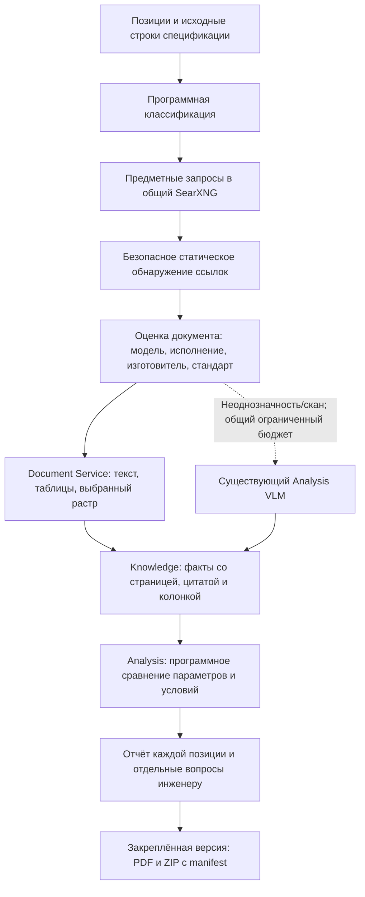

# EQ: поиск документов, применимость и самостоятельная выгрузка

## Исходная точка

Изменения подготовлены поверх `feature/quality`, `bc2aef7d870d3d1eff858fad04ff82060e92a830`.
HEAD публичной ветки сверен через GitHub. Правила shared сверены с
`839d419432fc25bc988e5871f7e53f6d282a2e77`; общий SearXNG остаётся в shared.
Публичный `main` — `8fd5adcdf1db9088f182f69bee7e7df1ef9ca2b1`.
Изменения всех этапов поставляются одним коммитом пользователя. Агент не выполняет commit/push.

В диагностике задания `b6d9d242-f53e-403c-822c-84369a9cb1ad` было 7 моделей,
по 3 запроса и 2 попытки загрузки, без подтверждённых документов. Поисковик
возвращал ссылки; это не доказывало работоспособность остальной цепочки.
Приложенный PDF `(14)` использован для осмотра спецификации на странице 26.
Это результат прежнего анализа, а не новый серверный прогон после изменений.

Причины:

- строки без серийной модели не получали предметную стратегию;
- HTML-карточка проверялась сразу, без обнаружения ссылок на паспорт;
- нейтральные запросы почти не различали оборудование, материал и конструкцию;
- отсутствие бренда в локальном реестре блокировало определение нового изготовителя;
- HTML и документы расходовали один тесный бюджет;
- паспорт ВСКМ содержит таблицу из 19 колонок; прежний предел 16 исключал её;
- состояние поисковика, применимость и результат сравнения сводились к «Не проверено»;
- не было отдельного PDF/ZIP по завершённой фоновой версии EQ.

## Реализованный путь



Поддерживаются категории `serial_equipment`, `standard_product`, `material`,
`prefabricated_structure`, `designed_structure`, `unidentified`. Публичная
маркировка и стандарт участвуют в запросах; шифр проекта, Under, соседние
проектные тексты и внутренние обозначения не добавляются в запросы.
Идентичность справочной позиции включает стандарт/редакцию: одинаковое
наименование с разными ГОСТ не объединяется в один поиск.

HTML читается без исполнения JavaScript. Относительные ссылки, ссылки без
`.pdf` и подписи перед значком скачивания сохраняются. Большое меню не
должно скрывать документы после первых 256 ссылок: статический разбор
ограничен 1024 ссылками и 2 МБ HTML, затем выполняется ранжирование.
Для исходного HTTP-href формируется отдельная HTTPS-попытка. Это не включает
разрешение HTTP, не отменяет TLS и не разрешает redirect на новый hostname.
JavaScript/CAPTCHA/challenge дают явную диагностику.

Изготовитель может быть установлен по явной подписи в прочитанном документе
либо существующему проверенному реестру. Домен продавца не назначается
изготовителем. Добавлена подтверждённая запись Декаст/decast.com по первичным
источникам: [о компании](https://decast.com/about/) и паспортам ВСКМ90.
Миграция не повышает ранее принятые pending/blocked решения до trusted.
Справочные источники без изготовителя видны отдельной группой; фиктивная
строка производителя в БД не создаётся.

В одном паспорте/руководстве уникальная подпись изготовителя может находиться
на другой странице, чем модель. Страница подписи сохраняется отдельно.
Правило не переносится на общий каталог продукции. При адресном VLM-чтении
приоритет имеет страница точной модели, затем другие технические страницы;
обложка не должна расходовать оба чтения до страницы нужной модели.

Применимость отделена от доверия сайту: точная модель/исполнение, семейство,
справочник, частичное совпадение и предметные отказы отражаются в кандидате.
Стандарт или типовой каталог не подтверждает конкретную поставку. Его факты
сохраняются как `technical_reference`, с пониженной доказательной силой.
При неполном чтении большого PDF нельзя объявлять отсутствующую на первых
страницах модель доказанно другой моделью.

Сравнение различает наружный и условный диаметр, толщину стенки, рабочее и
номинальное давление, номинальный и максимальный расход, объём. Поддержаны
м³, м³/ч, л/с, МПа, кПа, бар, кН. Разные роли AC/DC, каналы, исполнения,
режимы и условия по-прежнему не смешиваются. Отсутствие проектного или
документального параметра и несопоставимость условий имеют отдельные
диагностические результаты. Извлекатель Knowledge имеет версию 10;
исторические наборы фактов не перезаписываются.

## Квоты, повтор и сохранность

Сохраняются существующие общие бюджеты запросов, документов и VLM.
Новые настройки в `.env.example` читаются существующим `env_file` Compose:

| Настройка Equipment Search Service | По умолчанию | Предел |
|---|---:|---:|
| `PAGES_PER_MODEL` | 6 | 1–20 |
| `EXTRACTIONS_PER_MODEL` | 6 | 1–20 |
| `DISCOVERY_DEPTH` | 2 | 0–3 |
| `LINKS_PER_PAGE` | 5 | 1–10 |

Префикс всех переменных: `EQUIPMENT_SEARCH_SERVICE_`. В одном справедливом
проходе допускается до 3 просмотров HTML и 4 извлечений, в пределах оставшейся
квоты позиции. HTML не расходует квоту успешно загружаемых PDF. Число сетевых
попыток, расход квоты документов и извлечения учитываются отдельно.

SearXNG сохраняет частичную выдачу и причины `unresponsive_engines`.
Сетевые/429/временные HTTP-отказы имеют не более двух попыток с backoff и jitter.
Недоступность поиска не выдаётся за отсутствие документа. Для каждого URL
есть устойчивый ID, цепочка переходов, SHA, тип, оценка и причины отказа.
Секретные параметры URL удаляются из пользовательской диагностики.

Квоты резервируются до внешней операции. После получения bytes создаётся
content-addressed blob и долговечный checkpoint. Это не присваивает кандидату
доверие или применимость. После прерывания проверка может использовать этот
blob без новой загрузки и без нового поискового запроса. SHA проверяется.
Готовые наборы и версии задания остаются неизменяемыми; отмена прекращает
новые внешние операции. При новой генерации повторяются только допускающие
повтор состояния, а завершённые модели сохраняются.

## Интерфейс и поставка документов

Таблица показывает каждую позицию, даже если одинаковые изделия используют
один поиск. В подробностях доступны тип позиции, найденные/отклонённые
кандидаты, состояние этапа, причины, извлечённые значения и сравнения.
Статус и полнота сравнения рассчитываются по собственной строке: подтверждённая
позиция не подтверждает соседнюю позицию той же модели без проектных параметров.
Разрешение неподтверждённых сайтов действует только для своего задания и
действительно разрешает загрузку, извлечение и сравнение. Оно не снимает
пометку происхождения и не отменяет блокировку сайта.

Новые GET-маршруты в области доступного анализа:

- `/api/v1/analyses/{job_id}/equipment-search/report.pdf?revision=7`;
- `/api/v1/analyses/{job_id}/equipment-search/documents.zip?revision=7`.

Версия обязательна. Содержание берётся сервером из неизменяемой EQ-версии;
браузер не передаёт замечания, факты и документы. Незавершённая версия не
экспортируется. PDF создаёт существующий Document Service. ZIP содержит PDF,
реально использованные сохранённые PDF/HTML и `manifest.json`: версия,
применимость, доверие, URL, страницы, факты, сравнения и SHA-256. Один файл
кладётся один раз для нескольких позиций. Несовпадение SHA, некорректный
source ID, неподдерживаемый формат или превышение 100 МБ дают отказ вместо
выдачи неполного комплекта.

Основная геометрия Review, авторизация/регистрация, команды замечаний,
сохранение ручных областей и исходный PDF не перерабатывались. Общий writer
PDF получил только необязательную подпись раздела; прежняя подпись
«Замечания» сохранена по умолчанию. PDF EQ проверен рендером отдельного образца.

## Проверки: что действительно измерено

Начальная регрессия воспроизведена до реализации: новый тест не находил модуль
обнаружения; это не было доказательством успешного поиска. После реализации
изолированные HTTP-проверки используют настоящие PDF/HTML bytes, действующие
Document/Knowledge endpoints и программное сравнение, без заранее заданных
инженерных замечаний и без обращений к GPU. Контрольный набор выполняется
примерно за 12 секунд, меньше двух минут.
Окончательный контрольный набор: 206 проверок за 11,77 секунды.

| Контроль | Прежний отказ | Новая проверка |
|---|---|---|
| ВСКМ 90-20 / 90-40 | `manufacturer_unknown` и чужие модели | Точная подпись изготовителя принимается; соседняя модель отклоняется; таблица 19 колонок сохраняется |
| ШПК-320Н / 310Н | Сетевая ошибка/неподходящая модель | Различение моделей на HTTP-фикстурах; реальный Rusarsenal дал timeout |
| MEAN WELL DRC-100B | Необработанный переход со страницы | HTML → маршрут скачивания → реальный extractor → свойство нужной колонки → программное сравнение |
| МКУ-24-8-К | Превышенный размер документа | Неверная модель не принимается; прежний безопасный лимит размера сохранён; успех реального большого паспорта не заявляется |
| ВСХНд-50 | Неустановленный изготовитель/лимит | Реально скачаны два руководства; модель/изготовитель связаны на стр. 8/12 и 10/14. Это разные изготовители, они не смешиваются. Генерация VLM на сервере здесь не измерялась |
| ПЭ100 SDR11 110×10 | Поиск не выполнялся | Категория, стандарт, наружный диаметр и толщина стенки передаются без выдуманной серийной модели |
| Люк Т(С250) | Поиск не выполнялся | Стратегия типового изделия и справочника; класс не превращается в паспорт неизвестного изготовителя |
| Резервуар 100 м³ | Поиск не выполнялся | Проектируемая конструкция; справочник не заменяет расчёт, чертёж и паспорт конкретной поставки |
| Песок/колодцы | Поиск не выполнялся | Материал/сборная конструкция, стандарт или серия; все позиции остаются отдельными |

Отдельная реальная загрузка безопасным production-загрузчиком 02.11.2026:

- паспорт Decast ВСКМ90: 404664 байта, SHA `719486e096f4ebc4b6631e5f17dccefc3eb4d068193f9d2bb5beb9653645c359`;
- PDF MEAN WELL: 727146 байт, SHA `4ae1ebcf313e277c1593a0415e2182543779f0d46b7107d977ed2c1b80940a47`;
- страница Teplovodomer: HTML получен; выявлены ссылки после большого меню;
- карточка Decast: HTML 200, но challenge требует JavaScript;
- паспорт Rusarsenal: timeout при ограничении 15 секунд.

Дополнительная загрузка 03.11.2026 после ранжирования по полной строке таблицы:

- Teplovodomer DN40–250: 846177 байт, 20 страниц, 45738 символов извлечённого текста,
  SHA `b92c3d939bf815db68638dbebc15e75498cfc80274a3cedbaa21a788acec38a8`;
- Apator DN40–250 с того же сайта: 757846 байт, 22 страницы, 45823 символа,
  SHA `079c6c60aa1b15b85ebd5c4c163ea355f6c9e11c896adcd6bd927ba65b8cb8da`.

На этих настоящих bytes повторно выполнена программная оценка. Установлены
`АО «Тепловодомер»` на стр. 12 при модели на стр. 8 и `APATOR PoWoGaz SA` на
стр. 14 при модели на стр. 10. Это проверка чтения и межстраничной привязки
документации, а не новый анализ проекта или подтверждение всех характеристик.

Эти наблюдения не являются новым серверным анализом проектного PDF, замером
полноты инженерных замечаний или проверкой доступности общего SearXNG из
промышленного контейнера. Серверные VPN/DNS, внешние сайты и фактический VLM
нужно подтвердить после поставки. Отсутствие всех паспортов не является
провалом, если зафиксирована правильная причина и не подменены доказательства.

Полные журналы локальных проверок лежат в игнорируемом `.codex-test-temp/`:
`eq-acceptance-final.log`, `eq-windows-quality-verified.log`,
`eq-linux-quality-final.log`, `eq-linux-general-verified.log`.

| Проверка | Результат |
|---|---|
| Штатный Windows gate | 3339 Python passed, 132 skipped; 407 JS passed; Ruff и формат проходят |
| Общий Linux gate на окончательном коде | 3340 Python passed, 131 skipped; 407 JS passed |
| PostgreSQL Gateway / Knowledge / Experience / User / Auth / Equipment | 6 / 43 / 49 / 31 / 14 / 159 passed, всего 302 |
| Контрольный EQ-набор без GPU | 206 passed за 11,77 секунды |
| Проверка источников образов | 58 файлов совпали по SHA-256 с рабочей копией в общем quality-образе и Equipment PostgreSQL-образе |

`ops/check-quality.sh` завершил все семь этапов с кодом 0. После последнего
исправления межстраничной привязки отдельно повторён его общий этап на
окончательном коде. Equipment PostgreSQL-образ также содержит этот код;
совпадение файлов проверено, включая новые регрессионные тесты.
Windows gate завершён на той же окончательной версии с кодом 0.
Различия skipped относятся к условиям среды; отдельные PostgreSQL-наборы
действительно выполнены в изолированных контейнерах.

Эти результаты подтверждают программные регрессии и контракты. Readiness
промышленного стека, новый n8n-прогон, фактические вызовы VLM и ручной Review
после поставки пока не подтверждены; их нельзя заменить успешными unit-тестами.

## Windows → один коммит → Linux

Список изменённых файлов: `docs/eq-document-discovery-files.txt`. Большие PDF,
HTML, PNG и журналы из `.codex-test-temp/` не входят в Git.

```powershell
.\ops\check-quality.ps1
if ($LASTEXITCODE -ne 0) { throw 'Quality gate завершился ошибкой' }
git add --pathspec-from-file=docs/eq-document-discovery-files.txt
git diff --cached --check
git diff --cached --stat
git commit -m "feat(eq): discover applicable documents and export evidence bundles"
git push origin feature/quality
```

У текущего локального `origin` два push URL: публичный Amadu-A и приватный
neo-term-it. Поэтому одна команда push отправляет коммит в оба репозитория.
Если конфигурация remotes менялась, предварительно проверить `git remote -v`.

```bash
cd ~/projects/PDRD-validation
git pull --ff-only origin feature/quality &&
bash ops/check-quality.sh &&
bash scripts/up.sh &&
bash scripts/check-stack.sh
```

Новая миграция Equipment Search — `20261102_0006`; штатный `up.sh` применяет
миграции. Не пересоздавать Qdrant, embedding или атомарные нормативные поколения.
Общий SearXNG уже развёрнут: второй экземпляр и отдельный секрет не нужны.

Изменён **только** workflow `n8n/workflows/analysis-v2-pdf.json`: передаются
категория, справочное обозначение и позиции отчёта. После поставки импортировать
этот файл в существующий workflow, проверить сохранность credentials и webhook,
выполнить **Save → Publish**. Остальные workflows импортировать не требуется.

## Ручная приёмка

1. Открыть frontend, проверить вход/регистрацию и выбор раздела. Запустить **новый**
   анализ с EQ и разрешением неподтверждённых сайтов. Старое задание имеет
   неизменяемый вход и не получает новые позиции через resume.
2. На спецификации страницы 26 проверить наличие песка, труб, люков, колодцев,
   упоров и обоих объёмов резервуара. Посмотреть типы и предметные состояния;
   справочник не должен отображаться подтверждением поставки.
3. Раскрыть подробности: видны кандидаты, причины, применимость, извлечённые
   характеристики и проектные значения. Соседние модели/исполнения не смешаны.
4. Проверить отмену и продолжение EQ: готовые результаты остаются, budgets не
   сбрасываются рестартом, повторное чтение уже сохранённых bytes возможно.
5. Скачать самостоятельные PDF и ZIP после завершения фонового EQ. Сверить
   номер версии, позиции, страницы, файлы и manifest. Проверить исходный PDF
   и скачивание Review PDF как отдельные операции.
6. Добавить, отредактировать, принять/отклонить автоматическое замечание,
   изменить обе геометрии, сохранить и перезагрузить Review. Создать и удалить
   gold без вопроса о причине; проверить, что новые EQ-находки добавляются
   явным действием и не изменяют утверждённый Review.
