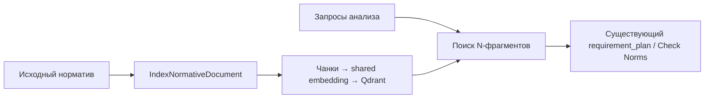
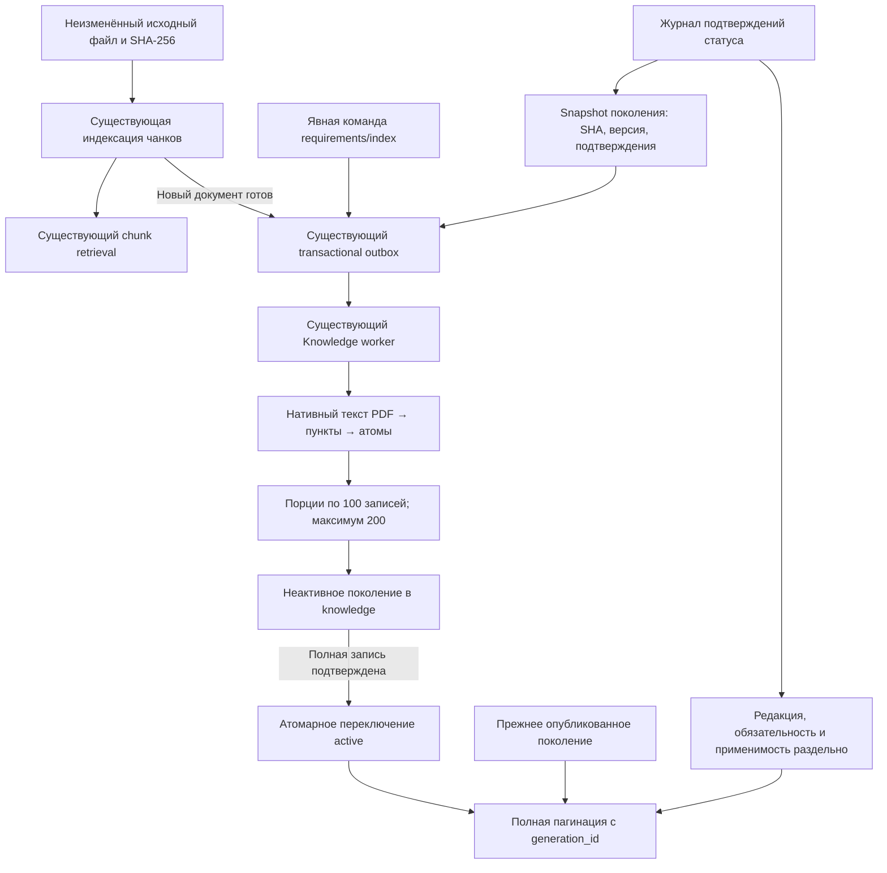

<!-- docs/normative-atomic-stage-a.md -->

# Атомарный нормативный каталог — этап A

Исходная ветка `feature/quality`, проверенный исходный HEAD
`7f133260dd9c9a9069f63b49bc0e7edff077ca77`. Реализация соответствует этапу A
ТЗ «Полноценный N-first». Этапы B (независимый план проверок полного выбранного
корпуса) и C (сквозные N-ссылки, Review/PDF и инженерная приёмка) ещё не реализованы.
Этот этап сам по себе не увеличивает число инженерных обнаружений анализа.

## Архитектура до и после

До изменения Knowledge сохранял перекрывающиеся текстовые чанки. Набор
нормативных фрагментов анализа зависел от retrieval-запросов и их top-K.
Существующий `requirement_plan` не являлся перечнем всех требований документа.



После изменения атомарный каталог дополняет тот же Knowledge Service, PostgreSQL
схему `knowledge`, outbox и очередь `pdrd.knowledge.indexing`. Новых сервисов,
брокеров, векторных коллекций, shared runtime или GPU-настроек нет.



Frontend, геометрия, Review, PDF-экспорт, Analysis Service и n8n workflow не менялись.
Действующий Check Norms пока читает прежний контракт поиска; новый полный каталог
будет подключаться в этапе B. Перепубликация workflow для этапа A не нужна.

## Что извлекается и что сохраняется

`NormativeRequirement` использует принятые названия `page`, `source_text`, `text`.
Он содержит `requirement_id`, `point_id`, UUID исходного документа, SHA-256,
обозначение и редакцию из оригинала, пункт/подпункт, буквальный атом и полный
исходный пункт. `source_fragments` содержит физическую страницу, символьные
смещения `start`/`end` в нативном тексте и точный текст фрагмента. Геометрические
bbox не выдумываются. Контракт исходного файла остаётся
`GET /api/v1/normative/documents/{document_id}/content`.

Сохраняются заголовки, общий заголовок перечисления, условия, исключения,
примечания и сноски в полном пункте, а также буквальные ссылки на зависимые пункты,
таблицы и приложения. Межстраничное продолжение объединяется с происхождением
каждой части, включая пустую физическую страницу. Перенесённые ссылки на СП и
пункты не становятся новыми пунктами. Числа табличных строк не извлекаются
отдельно от таблицы и её примечаний.

Классифицируются числовые ограничения, формулы, таблицы, классификации,
обязательные действия, состав систем, расчётное обоснование, условные требования,
альтернативы и оформление документации. Сложные таблицы/формулы/условия остаются
`needs_review`; классификация ещё не означает исполнимый алгоритм проверки.
Неподдержанный и справочный текст сохраняется. Рекомендация или разрешение
не превращается в обязательное предписание. Разделы определений и нормативных
ссылок, справочные приложения и слова «необходимости»/«должностных» не создают
обязательную модальность по совпадению части слова.

Это детерминированный извлекатель нативного текста `normative-native-v1`, без OCR
и модельного смыслового разбора. Титул и прочий контекст также сохраняются с
ограничениями, поэтому `count` не равен числу обязательных нормативных предписаний.
Ошибки распознавания сложной структуры остаются предметом последующей верификации.
`manifest.source_coverage=native_text_only` и `source_text_empty_pages` явно
показывают границы исходного текста. Пустой или нечитаемый источник не подтверждает
отсутствие требований. `coverage_basis=complete_atomic_generation` означает полный
набор записей конкретного поколения, а не охват всех действующих норм.

## Доказательства нормативного статуса

`READY` исходного документа и `ready` поколения показывают техническую готовность.
Отдельный `NormativeStatusEvidence` содержит обозначение, редакцию, SHA исходного
файла, статус редакции, обязательность, область пунктов, область применения,
URL и буквальную цитату подтверждающего источника, дату подтверждения, период
действия, автора и серверное время записи.

Оператор с `normative.write` предварительно проверяет подтверждающий источник.
API сохраняет его аттестацию, проверяет форму/область/даты и идентичность источника;
самостоятельной юридической экспертизы или автоматического получения реестра нет.
URL не загружается сервером. Автор берётся из проверенной сессии Gateway; поля
автора, SHA и серверного времени не принимаются в пользовательском JSON.

Статусы редакции: `current`, `withdrawn`, `unknown`, `disputed`.
Обязательность: `mandatory`, `voluntary`, `unknown`, `disputed`.
Запись относится только к тому же UUID, SHA, обозначению, редакции, периоду и
явной области пунктов. `5.1` охватывает подпункты `5.1.*`, но не `5.10`;
`5.1.а` ограничивает подтверждение подпунктом, `*` обозначает весь документ.
Противоречащие подтверждения дают `disputed`, а не выбор последней записи.
Применимость к конкретному проекту остаётся `not_assessed` до этапа B.

Журнал дополняется, прежние записи не перезаписываются. Изменение подтверждений
меняет fingerprint поколения. До явного построения нового поколения прежнее
остаётся читаемым, но его нормативные статусы возвращаются как `unknown` с
`status_evidence_changed`. Фиктивные свидетельства тестов не подтверждают статус
реальных СП. Для исследованного корпуса проверенных свидетельств пока нет.

## Контракты API

Публичный префикс: `/api/v1/normative/documents/{document_id}`.
Внутренний: `/internal/v1/normative/documents/{document_id}`.

| Метод и суффикс | Результат |
|---|---|
| `GET /requirements/index` | Состояние требуемого и активного поколений; чтение ничего не запускает |
| `POST /requirements/index` | `202`, явная постановка атомарного построения через outbox |
| `GET /requirements` | Полный постраничный каталог опубликованного поколения |
| `GET /status-evidence` | Журнал подтверждений для текущего SHA |
| `POST /status-evidence` | `201`, аттестация оператором с проверенной сессией |

`GET /requirements` принимает `generation_id`, `offset >= 0`, `limit` от 1 до 200,
`assessed_on` в формате даты. Ответ содержит поколение и snapshot подтверждений,
`requirements`, `count`, `next_offset`, `historical_source`,
`status_evidence_changed`, `coverage_basis`, `vlm_calls`, `embedding_calls`.
На следующих страницах обязательно передавать полученный `generation_id`.
Иначе смена активного поколения между запросами может изменить набор.
Публикация/восстановление не меняет уже опубликованные атомы старого поколения.

Чтение без готового поколения даёт `404`, незавершённое поколение или изменение
источника без явной индексации — `409`. Историческое поколение другого SHA
доступно только при явном `generation_id` и помечается `historical_source`.
UUID поколения другого документа не открывает данные.
Проверки доступа к разделу, permissions, сессии и Origin выполняет действующий
Gateway. Личные U-пакеты не индексируются этим контрактом как нормативы.

Поля `POST /status-evidence`: `document_code`, `edition`, `edition_status`,
`requirement_binding`, `clause_scope`, `applicability_scope`, `source_url`,
`source_quote`, `confirmed_on`, `valid_from`, `valid_until`. Дополнительные поля
запрещены. Длины, число пунктов и период ограничены схемой/доменом.
Не отправляйте подтверждение реального СП на основании тестового примера.

## Поколения, ошибки и восстановление

Миграция Knowledge `20261020_0009` после `20261008_0008` создаёт три пустые таблицы:
`normative_requirement_generations`, `normative_requirements`,
`normative_status_evidence`. Рабочие документы и Qdrant не меняются; данные
не переписываются. FK действуют только внутри схемы владельца.

Идентификатор поколения зависит от UUID, SHA, версии извлечения и snapshot
подтверждений. Идентификатор атома дополнительно учитывает пункт, подпункт,
страницу, исходное смещение и буквальный атом. Разные файлы/редакции/версии
извлечения не смешиваются. Изменение алгоритма после поставки требует новой
`EXTRACTOR_VERSION`.

Новая загрузка N-документа после готовности чанков ставит атомарную задачу.
Уже готовый корпус не переиндексируется при старте, миграции или GET.
Для него оператор явно вызывает новый `POST .../requirements/index` по одному
согласованному документу. Прежний `POST .../index` по-прежнему управляет чанками;
его не нужно вызывать для атомарного каталога.

Worker проверяет SHA байтов, пишет порции с короткими транзакциями и блокировкой
документа, проверяет итоговое число строк, затем в одной транзакции переключает
`active`. При ошибке пишет `failed` и `error_code`, сохраняет старое рабочее
поколение и повторно поднимает исключение. Программные ошибки не маскируются
пустыми результатами. Повторная явная команда восстанавливает `failed`.
Недавно поставленная задача идемпотентна; повтор активной сборки даёт `409`.
После десяти минут без обновления явная команда может восстановить `queued` или
`building`; прежняя попытка теряет lease и право записи/публикации.
Это восстановление по команде, а не бесконечный фоновый retry.
Если оператор возвращает исходник с прежним SHA и тем же журналом подтверждений,
явная команда повторно активирует уже проверенное готовое поколение; его атомы
не пересоздаются. Поколение заменённого исходника также остаётся в истории.

## Локальный прогон реальных PDF

Проверены полные исходные PDF существующего локального корпуса: SHA проверен
перед чтением; извлекатель и application-сценарии production, persistence
транзакционный тестовый. PostgreSQL, RabbitMQ и опубликованный n8n в этот прогон
не входили. Проверены повторяемость IDs, буквальность атомов, смещения каждого
фрагмента и полный перечень физических страниц в manifest.

| Источник | Физических страниц | Записей, включая контекст | Модальность mandatory | Требуют проверки |
|---|---:|---:|---:|---:|
| СП 129.13330.2019 | 57 | 872 | 293 | 837 |
| СП 31.13330.2021 | 139 | 2397 | 1204 | 2293 |
| СП 8.13130.2020 | 22 | 310 | 95 | 296 |
| СП 89.13330.2016 | 98 | 2217 | 915 | 2110 |

Всего 316 физических страниц и 5796 записей. Нативные цитаты проверены по 9287
фрагментам страниц. В измеренном локальном запуске построение одного документа
заняло 0.51–4.79 с, включая тестовую persistence; это не время серверного анализа.
Дополнительных VLM/embedding-вызовов — 0. Правовой статус всех четырёх источников
`unknown`, применимость к проекту не оценивалась. Эти числа не являются метрикой
роста качества и не подтверждают, что все смысловые требования правильно атомизированы.

Реальные страницы зафиксированы в
`tests/fixtures/engineering/normative-atomic-source-pages.json`; СП 8 представлен
целиком, СП 31 и СП 129 — выбранными физическими страницами. Это исходный текст,
а не готовые findings или ожидаемые нарушения H01–H35.

## Проверки и поставка

Финальная локальная проверка 20.10.2026:

| Проверка | Результат |
|---|---|
| Целевой новый набор unit/functional/HTTP/architecture/security/реальных страниц | 71 passed, 2.00 с |
| Проверки образа, запуска и совместимости каталогов | 39 passed, 2.45 с |
| Общий Windows gate: Python | 2986 passed, 117 skipped, 136.75 с |
| Общий Windows gate: frontend | 390 passed, 0 failed |
| `pip check`, Ruff check/format, `git diff --check` | Успешно |
| Alembic offline SQL | Успешно, без подключения к БД |
| Реальный PostgreSQL нового каталога | Подтверждён серверным логом `835cbfe`: Knowledge runner, 29 passed |
| Linux gate этапа A | По серверному логу `835cbfe` все 7 этапов прошли |
| Readiness / новый серверный анализ | Ещё не подтверждены; при поставке обнаружена ошибка прав образа |

Автотесты охватывают атомизацию/модальность/условия/исключения, таблицы и подпункты,
межстраничное продолжение, неполную цитату, редакции/SHA/версию, отказ порции,
идемпотентность и восстановление, старую попытку worker, статусы/даты/конфликты,
изоляцию U/разделов, API/пагинацию, запрет подмены автора, права/Origin и архитектуру.
Отдельный PostgreSQL-тест включён в существующий Knowledge integration runner:
реальные commit порций, сбой, active swap, повтор, журнал и каскадное удаление.

На Windows используется существующий gate:

```powershell
.\ops\check-quality.ps1
git diff --check
git status --short
```

Коммит и push выполняет разработчик после просмотра diff. У `origin` настроены
два push URL: публичный и приватный репозитории. Сам Codex commit/push не выполняет.

На Linux, в чистой копии `feature/quality`, с remote приватного репозитория:

```bash
cd ~/projects/PDRD-validation || exit 1
git status --short
git pull --ff-only origin feature/quality
bash ops/check-quality.sh && bash scripts/up.sh && bash scripts/check-stack.sh
```

Linux gate включает изолированную БД Knowledge и её новую миграцию. `up.sh`
применяет миграции до запуска runtime; readiness проверяет наличие трёх новых
таблиц. После прохождения gate поставка `835cbfe` остановилась на чтении
`20261020_0009_normative_requirements.py`: `PermissionError` в рабочем образе.
Root-пользователь quality image прочитал файл, runtime-пользователь `app` — нет.

Исправление поставки нормализует права скопированного `/app` в Dockerfile
Knowledge: каталоги `0755`, файлы `0644`, владелец остаётся root. Пользователь
`app` получает чтение/проход, без права записи кода. Исходные права checkout и
umask больше не определяют доступность миграций в образе. После `USER app`
сборка выполняет `python -m alembic -c /app/alembic.ini heads`: читает все настоящие
ревизии без подключения к БД. Ошибка чтения теперь останавливает сборку образа.
Регрессионный тест закрепляет выполнение этой проверки от runtime-пользователя.
Содержимое миграции и схема БД этим исправлением не меняются.

В локальной рабочей среде Docker daemon недоступен. Для исправленного образа
сборка, повторный Linux gate и readiness должны быть подтверждены на сервере.
После пересборки команда `docker compose run --rm --no-deps knowledge-service
alembic heads` должна успешно показать `20261020_0009 (head)`.

Ручная приёмка:

1. На обычном HTTPS frontend открыть прежний анализ: проверить просмотр PDF,
   создание/изменение размеров/сохранение замечания, повторное открытие Review,
   утверждение/удаление и оба варианта скачивания PDF.
2. С авторизованной страницы от имени оператора взять UUID одного доступного
   N-документа. Через API выполнить `GET .../requirements/index`: для прежнего
   корпуса ожидается `not_indexed`, без фоновой индексации при чтении.
3. Явно выполнить `POST .../requirements/index`, дождаться `ready`; пройти все
   страницы `GET .../requirements?limit=100`, закрепляя `generation_id`.
   Сверить сумму записей с `count`, manifest страниц, SHA, выбранные реальные
   пункты, исходные цитаты и физические страницы PDF. До подтверждения оператором
   нормативный статус должен оставаться `unknown`.
4. Повторить POST: готовое поколение и число атомов не меняются. Проверить, что
   обычный поиск нормативов и анализ по выбранному разделу работают как прежде.
   Для этапа A дополнительные обнаружения H-кейсов не ожидаются.

Серверный E2E исходного ИОС2.2, сравнение H01–H35, восстановление H10 и независимые
нормативные проверки H01/H02/H08/H12/H18 относятся к этапам B/C. Их результаты
в этом этапе не измерены. Полноценный N-first для production ещё не принят.
