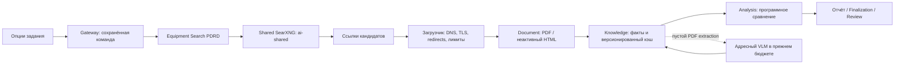

<!-- docs/shared-equipment-search.md -->

# Общий SearXNG и проверка характеристик оборудования

Дата проверки: 02.11.2026. Рабочая ветка: `feature/quality`.
Исходный HEAD PDRD: `305806ba385e9a9f44615eb32ffd1c324763970e`;
он совпадает с GitHub. `main`: `8fd5adcdf1db9088f182f69bee7e7df1ef9ca2b1`.
Актуальный shared main: `839d419432fc25bc988e5871f7e53f6d282a2e77`.
Прочитаны LLM_CONTEXT и применимые Engineering/Infrastructure правила,
[реестр shared](https://github.com/Amadu-A/shared_infrasktructure/blob/839d419432fc25bc988e5871f7e53f6d282a2e77/docs/services.yaml).

## Результаты ревью

1. PDRD создавал собственный SearXNG, использовал ключ EQ API как его секрет,
   а Equipment Service не подключался к `ai-shared`. Теперь общий runtime
   потребляется через `http://searxng:8080`; образ, настройки и `SEARXNG_SECRET`
   принадлежат shared. Прикладной Equipment Service, его БД, документы, очередь,
   миграции и доверие к источникам остаются в PDRD.
2. Доверие сохранённого паспорта устаревало после решения администратора.
   Новый запуск читает актуальное разрешение источника; исторические bytes и
   metadata snapshot не переписываются. Blocked и disabled не обходятся галкой.
3. `allow_unverified` разрешал загрузку, но Analysis обнулял уверенность фактов
   по самому статусу сайта. Теперь при серверном разрешении этого задания
   выполняется сравнение значений. Пометка источника сохраняется, замечание
   по неподтверждённому источнику остаётся вопросом инженеру. Для нового запуска
   без разрешения такой источник не используется.
4. Пустой набор EQ Facts записывался в immutable-кэш. Последующее адресное чтение
   того же SHA не могло его дополнить. Версия извлекателя повышена с 8 до 9;
   пустые результаты не кешируются. Старые наборы не удаляются и не меняются.
5. Читаемый PDF с пустым extraction ошибочно завершался как `found`. Теперь
   после программного прохода выполняется ограниченное адресное чтение в
   существующем общем бюджете. Если фактов нет, результат — `incomplete`,
   с машинной причиной. Текстовый документ с готовыми фактами не требует VLM.
6. Заголовки модели, переносы подписи/значения, русские диапазоны и многоуровневые
   колонки не обрабатывались. Теперь сохраняются модель, канал и вид величины:
   номинал, rating, допустимый диапазон и настройка различаются. Соседние колонки
   не назначаются последней модели из линейного PDF-текста.
7. HTML терял кириллицу windows-1251 и структуру некоторых блоков. Исправлены
   разрешённые кодировки, границы строк и разделители колонок. Текст HTML до
   установленного предела Document Service 200 000 символов проходит в Knowledge;
   прежнее противоречие с лимитом 20 000 устранено.
8. Отказ всех поисковых движков SearXNG с HTTP 200 и пустой выдачей выглядел как
   отсутствие документа. Теперь он диагностируется как недоступность поиска.
9. Версии фонового EQ не сохраняли `allow_unverified`. Теперь разрешение входит
   в новые версии; для прежних оно восстанавливается из неизменяемой серверной
   команды задания. Из браузера это разрешение не выводится предположением.

## Границы и данные



Происхождение факта сохраняет EQ source ID, SHA, ревизию, URL, страницу,
строку/заголовок/колонку, канал и режим. Официальный точный домен может подтвердить
изготовителя при отсутствии его имени на странице модели; чужая модель и явная
чужая подпись изготовителя всё равно отклоняются. Поисковый snippet не доказательство.

Неподтверждённый сайт не становится глобально trusted. При разрешении пользователя
в отчёте сохраняется вычисленное совпадение/расхождение; вопрос о достоверности
остаётся отдельным. Документ без полного provenance не создаёт confirmed-нарушение.
Старые предметные вопросы не удаляются из-за неполного provenance.

Новых БД, миграций, сервисов и секретов PDRD нет. Qdrant/embedding runtime,
параметры модели, N/T/U/D, геометрия Review и прикладной frontend не изменялись.
Для EQ при холодном чтении новой версии могут создаваться собственные
версионированные индексы snapshot; нормативный корпус не переиндексируется.
Новые/изменённые ключевые операции используют существующие timing/logging
механизмы; Docker rotation остаётся `local`, 10 MiB × 5.

## Проверки

Первое воспроизведение: **9 failed**, до production-исправлений:
`.codex-test-temp/shared-search-red.log`.
Целевой набор после исправлений: **514 passed за 64,15 s**.
Настоящие HTTP Document/Knowledge и PDF/HTML fixtures: **8 passed за 1,66 s**.
Первый общий gate выявил три регрессии. Исправлена опасная привязка соседней
колонки; остальные проверки сохранены, разрешение задания передаётся явно.
Повтор затронутых функциональных сценариев: **30 passed за 2,81 s**.
Финальные штатные gates завершились с exit code 0:

| Набор | Результат | Время pytest |
| --- | --- | ---: |
| Windows, Python 3.14 | 3291 passed, 130 skipped | 300,38 s |
| Windows JavaScript | 405 passed | — |
| Linux, Python 3.12 | 3292 passed, 129 skipped | 277,88 s |
| Linux JavaScript | 405 passed | — |
| Gateway PostgreSQL | 6 passed | 0,86 s |
| Knowledge PostgreSQL | 43 passed | 8,14 s |
| Experience PostgreSQL | 49 passed | 6,43 s |
| User PostgreSQL | 31 passed | 3,46 s |
| Auth PostgreSQL | 14 passed | 1,81 s |
| Equipment PostgreSQL | 138 passed | 15,71 s |

Все 7/7 этапов Linux gate пройдены. Отдельно от общего набора — 281 тест
в изолированных PostgreSQL-контурах, с реальными миграциями и без рабочей БД.
Проверки pip, Ruff lint/format и git diff --check прошли. В Linux image SHA всех
31 Python-файла поставки совпадает с рабочей копией.

Логи: `.codex-test-temp/shared-search-quality-windows-release.log` и
`.codex-test-temp/shared-search-quality-linux-release.log`. Пропуски общего набора
включают DB-тесты, запускаемые отдельно. Linux сообщает предупреждение установленного
pytest-asyncio о будущем default loop scope; тесты не отключались и не исключались.
В этом окружении для разбора общего Compose использовались фиктивные значения
трёх обязательных переменных только в процессе тестирования; `.env` не менялся.

Первый общий прогон также обнаружил несоответствие сгенерированного user-guide
его единому источнику. Ручная добавка в generated-файл убрана, текущая справка
и frontend оставлены без изменений. Объяснение новой политики дано здесь.
Межсервисная HTTP-проверка находится в корневом functional-наборе, чтобы
самостоятельный образ тестирования Equipment не зависел от чужих Python-пакетов.

Изолированные тесты проверяют кэш, повтор, отмену, общий GPU-бюджет,
реальные PDF-колонки, кириллицу, HTML после 20k символов, разрешение pending,
запрет blocked, источник/страницу/SHA, текущие решения доверия и старые EQ-версии.

Отдельно штатным SafeDocumentDownloader получены публичные документы:

- [MEAN WELL DRC-100](https://www.meanwell.com/Upload/PDF/DRC-100/DRC-100-SPEC.PDF):
  727 146 bytes, SHA `4ae1ebcf313e277c1593a0415e2182543779f0d46b7107d977ed2c1b80940a47`.
  До исправления — 0 фактов; после — 5, с каналом и видом величины.
- [РИЭЛТА Пирон-Ш](https://rielta.ru/catalog/izveshchateli/optiko-elektronnye/piron-sh/):
  99 910 bytes, SHA `6f16498db781c6d06853d1240a2e73dd7e7e151ba3b3a91c665c2311670f07b1`.
  До исправления — 0 фактов; после — 4: питание, ток, температура и степень защиты.
- Публичный PDF Болид завершил загрузку по таймауту. Это не объявляется успешным
  тестом или доказательством отсутствия документа.

Публичные bytes и полные логи находятся только в игнорируемом
`.codex-test-temp/shared-search-live`; в Git их добавлять не нужно.
Это проверка настоящих документов, но не production E2E через опубликованный n8n.
Локальный Docker не имел запущенного shared SearXNG; сервер отклонил SSH-ключ.
На сохранённых публичных bytes также выполнены настоящие идентификация и сравнение:
контрольное значение вне диапазона настройки DRC-100B/CH1 даёт mismatch-кандидат;
характеристика Пирон-Ш из контекстного блока остаётся вопросом инженеру.
Отчёт: `.codex-test-temp/shared-search-live/live-smoke.json`.

## Windows и один коммит

Явный список файлов: [shared-equipment-search-files.txt](shared-equipment-search-files.txt).
Коммит и push выполняет пользователь после успешного gate и просмотра diff.
Подготовлены 42 изменённых/новых/удаляемых файла. Git index не менялся,
коммит и push не выполнялись. Исходный HEAD остаётся прежним до коммита пользователя.

```powershell
Set-Location C:\Users\i.mein\PycharmProjects\PDRD-validation
.\ops\check-quality.ps1
git diff --check
git add --pathspec-from-file=docs/shared-equipment-search-files.txt
git diff --cached --stat
git commit -m "fix(equipment): use shared search and recover documented property checks"
git push git@github.com:Amadu-A/PDRD-validation.git HEAD:feature/quality
git push git@github.com:neo-term-it/PDRD-validation.git HEAD:feature/quality
```

## Linux: shared, затем PDRD

Сначала завершить или отменить активный EQ через интерфейс. PostgreSQL, volumes
и сохранённые документы не удалять. Эти команды агент на production не запускал.

В private `.env` **shared** добавить `ai-search` к существующему COMPOSE_PROFILES
и задать отдельный `SEARXNG_SECRET` не короче 32 символов. Не использовать ключ
внутреннего API PDRD. Значения секретов не выводить и не присылать.

```bash
cd ~/projects/shared-infrastructure
set -euo pipefail
git status --short
git branch --show-current
git rev-parse HEAD
test -z "$(git status --porcelain)"
git pull --ff-only origin main
bash scripts/bootstrap.sh > /tmp/pdrd-shared-bootstrap.log 2>&1
docker compose --profile ai-search config --quiet
docker compose --profile ai-search up -d --no-deps searxng
docker compose --profile ai-search ps searxng
bash scripts/check.sh > /tmp/pdrd-shared-readiness.log 2>&1
```

Затем PDRD:

```bash
cd ~/projects/PDRD-validation
set -euo pipefail
git status --short
git branch --show-current
git rev-parse HEAD
test "$(git branch --show-current)" = feature/quality
test -z "$(git status --porcelain)"
git pull --ff-only origin feature/quality
docker compose config --quiet
bash ops/check-quality.sh > /tmp/pdrd-equipment-quality.log 2>&1
tail -n 25 /tmp/pdrd-equipment-quality.log
```

После проверки labels удалить **только прежнюю проектную копию SearXNG**.
Новый guard блокирует `up.sh` до ручного удаления, чтобы `--remove-orphans`
не удалял shared-сервис без проверки. Определяется точный namespace текущего PDRD;
команда не затрагивает shared SearXNG и не удаляет volumes:

```bash
project_name="$(docker compose config --format json | python3 -c 'import json,sys; print(json.load(sys.stdin)["name"])')"
test -n "$project_name"
test "$project_name" != shared
mapfile -t old_search < <(docker ps --all --quiet \
  --filter "label=com.docker.compose.project=$project_name" \
  --filter "label=com.docker.compose.service=searxng")
for container_id in "${old_search[@]}"; do
  docker inspect --format '{{.Name}} {{json .Config.Labels}}' "$container_id"
done
```

После просмотра, в том же терминале:

```bash
for container_id in "${old_search[@]}"; do
  owner_dir="$(docker inspect --format '{{index .Config.Labels "com.docker.compose.project.working_dir"}}' "$container_id")"
  test -n "$owner_dir"
  test "$(readlink -f "$owner_dir")" = "$(pwd -P)"
  docker stop "$container_id"
  docker rm "$container_id"
done
bash scripts/up.sh > /tmp/pdrd-equipment-up.log 2>&1
tail -n 25 /tmp/pdrd-equipment-up.log
bash scripts/check-stack.sh > /tmp/pdrd-equipment-readiness.log 2>&1
tail -n 25 /tmp/pdrd-equipment-readiness.log
docker compose ps
```

`up.sh` выполняет штатные миграции. Новых миграций в этой поставке нет.
Workflow n8n не менялись, повторный Import → Save → Publish не требуется.

Проверить не только HTTP readiness, но и настоящий JSON-поиск из потребителя:

```bash
docker compose exec -T equipment-search-service python - <<'PY'
import asyncio, json
import httpx
from pdrd_equipment_search_service.core.settings import Settings
from pdrd_equipment_search_service.infrastructure.searxng import SearxngSearch

async def main():
    async with httpx.AsyncClient(trust_env=False) as client:
        search = SearxngSearch(client, Settings().searxng_url)
        assert await search.is_ready()
        hits = await search.search('MEAN WELL DRC-100B datasheet', 5)
        assert hits, 'JSON-поиск доступен, но контрольная выдача пуста'
        print(json.dumps({'status': 'ready', 'hits': len(hits),
                          'hosts': sorted({h.hostname for h in hits})}))
asyncio.run(main())
PY
```

## Ручная приёмка

1. На PDF включить поиск и разрешение неподтверждённых источников. Запустить
   новое задание; документ должен скачиваться, а в EQ видны значения, страницы,
   пометка источника и фактический результат сравнения.
2. Для trusted сайта проверить контрольные совместимое и несовместимое значения
   точной модели/исполнения. Режим, канал и единицы должны совпадать; отсутствие
   этих данных даёт неопределённость, а не выдуманное нарушение.
3. Повторить с pending: без разрешения документ не используется, с разрешением
   значения сравниваются, замечание остаётся вопросом инженеру. Blocked запрещён
   в обоих режимах. Повторить после смены доверия и на тёплом кэше.
4. Отменить и продолжить фоновый EQ, добавить его сохранённую версию в Review.
   Разрешение сохраняется; старые замечания и ручные области не переписываются.
5. Проверить вход/выход, создание, редактирование, утверждение, удаление Gold,
   изменение обеих областей с сохранением после reload и оба PDF-экспорта.

Производственные DNS/доступность движков, полный прогон n8n, качество VLM и
реальные времена GPU из этой сессии не подтверждены. Readiness `/` проверяет
достижимость SearXNG, а не наличие результатов каждого внешнего движка.
